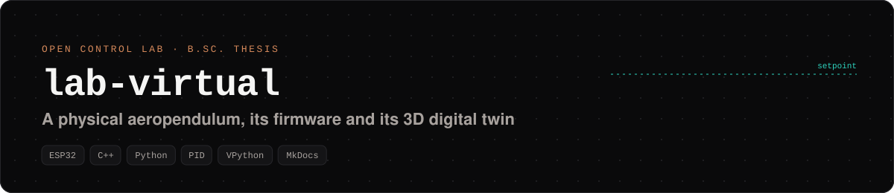
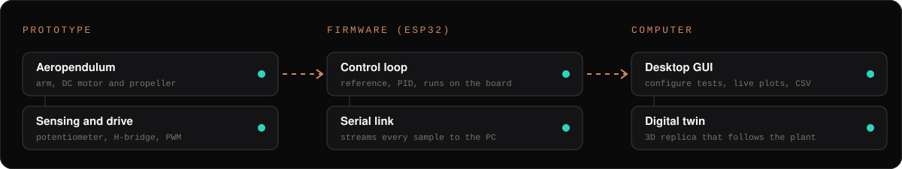

<div align="center">

<picture>
  <source media="(prefers-color-scheme: dark)" srcset=".github/assets/readme/banner-dark.svg">
  <source media="(prefers-color-scheme: light)" srcset=".github/assets/readme/banner-light.svg">
  
</picture>

<a href="https://oseiasdfarias.github.io/lab-virtual/"></a>
<a href="https://github.com/Oseiasdfarias/lab-virtual/actions/workflows/docs.yml"></a>
<a href="https://bdm.ufpa.br/handle/prefix/6944"></a>

            

**English** · [Português](README.pt-BR.md) · [About](#about-the-platform) · [How it works](#how-it-works) · [Getting started](#getting-started) · [Documentation](https://oseiasdfarias.github.io/lab-virtual/) · [Publication](#publication)

</div>

<table>
  <tr>
    <td width="33%"></td>
    <td width="33%"></td>
    <td width="33%"><a href="https://oseiasdfarias.github.io/lab-virtual/assets/simulador/aeropendulo_3d.html"></a></td>
  </tr>
  <tr>
    <td align="center"><sub><b>Prototype</b>: the physical plant</sub></td>
    <td align="center"><sub><b>Desktop interface</b>: data acquisition and tests</sub></td>
    <td align="center"><sub><b>3D digital twin</b>: <a href="https://oseiasdfarias.github.io/lab-virtual/assets/simulador/aeropendulo_3d.html">Three.js replica (demo)</a></sub></td>
  </tr>
</table>

## About the platform

**Virtual Lab** is an open platform to teach and experiment with modeling, system identification and control of dynamic systems. It brings a real physical system and the software to operate, observe and study it into one environment.

The plant is an **aeropendulum**: an arm on a pivot with a motor and a propeller at the tip. The propeller thrust lifts the arm, and its angle is measured and controlled in real time. It is simple to build and easy to see, but its dynamics are rich enough to cover a whole control course, from the physics of the system to a controller running on the hardware.

The project started as my undergraduate thesis in Electrical Engineering at UFPA (2023) and is kept as open material: hardware, firmware, software, test data and documentation all live in this repository.

## How it works

<picture>
  <source media="(prefers-color-scheme: dark)" srcset=".github/assets/readme/pipeline-dark.svg">
  <source media="(prefers-color-scheme: light)" srcset=".github/assets/readme/pipeline-light.svg">
  
</picture>

<p align="center">
  <picture>
    <source media="(prefers-color-scheme: dark)" srcset="./.github/assets/arquitetura-escuro.png">
    
  </picture>
</p>

The platform has four subsystems, with the **firmware** at the center:

| Subsystem | What it does | Built with |
| --- | --- | --- |
| **Prototype** | The physical plant: arm, DC motor with propeller, a potentiometer measuring the angle and an H-bridge driving the motor | Plywood and carbon fiber |
| **Firmware** | Reads the angle, generates the reference, runs the PID controller and drives the motor; the whole control loop runs on the microcontroller | C++ · ESP32 · PlatformIO |
| **Desktop interface** | Configures and starts tests, plots the signals in real time and saves the data to CSV | Python · CustomTkinter · Matplotlib |
| **Digital twin** | A 3D replica of the aeropendulum that follows, on screen, the motion measured on the prototype | Python · VPython |

The firmware talks to the prototype through the sensor and PWM, and to the computer through the serial port: it sends every sample to the interface and only receives the test configuration back. The interface forwards the data to the digital twin, which runs in the same Python program.

## What you can do

- **Run tests** in open or closed loop, choosing the reference waveform (square, sine or sawtooth) and setting amplitude, frequency and offset in the interface.
- **Watch the system in real time**, with plots of reference, angle, error and control signal, plus the 3D animation of the digital twin.
- **Record tests** to CSV for later analysis; the repository already includes the tests used in the thesis.
- **Study a full control project** with the documentation: modeling from physics, system identification from data and controller design.
- **Modify and extend** the firmware, the interface or the digital twin, all organized in modules.

## Documentation

The full documentation (in Portuguese) is at **[oseiasdfarias.github.io/lab-virtual](https://oseiasdfarias.github.io/lab-virtual/)**, in the same order as the project was built:

| Section | Content |
| --- | --- |
| [Overview](https://oseiasdfarias.github.io/lab-virtual/visao-geral/) | What the platform is and how the subsystems connect |
| [Prototype](https://oseiasdfarias.github.io/lab-virtual/prototipo/) | Structure, electronics and assembly |
| [Mathematical modeling](https://oseiasdfarias.github.io/lab-virtual/modelagem/) | System equations from physics |
| [System identification](https://oseiasdfarias.github.io/lab-virtual/identificacao/excitacao/) | Tests, model estimation and validation |
| [Control design](https://oseiasdfarias.github.io/lab-virtual/controle/pid/) | PID controller and closed-loop tests |
| [Digital twin](https://oseiasdfarias.github.io/lab-virtual/gemeo-digital/) | 3D simulator and integration with the interface |
| [Software](https://oseiasdfarias.github.io/lab-virtual/software/interface-grafica/) | Interface, firmware, installation and code reference |

## Getting started

**You will need:** the assembled prototype, an ESP32 board (TTGO T1), Python 3.10 or 3.11, [Poetry](https://python-poetry.org/) and [PlatformIO](https://platformio.org/).

**1. Flash the firmware**

```bash
cd softwares_aeropendulo/firmwares_microcontroladores/PlatformIo/Esp32_ttgo_modulos
pio run --target upload
```

**2. Install and open the interface**

```bash
git clone https://github.com/Oseiasdfarias/lab-virtual.git
cd lab-virtual/softwares_aeropendulo
poetry install
poetry run python rungui.py               # desktop interface
poetry run python rungui.py -simular sim  # interface + digital twin
```

With the prototype connected over USB, pick the port in the interface, configure the test and click run.

**3. Run the documentation locally** *(optional)*

```bash
pip install -r requirements-docs.txt
mkdocs serve
```

## Repository layout

```
.
├── softwares_aeropendulo/      # Desktop interface, digital twin, firmware and test data
├── docs/                       # Documentation site (MkDocs Material)
├── revisao_tcc/                # Thesis in LaTeX
├── materiais_complementares/   # Notebooks, modeling and identification studies, prototyping
├── docs_tcc/                   # Project summaries and publication planning
├── brand/                      # Visual identity
└── utils/                      # Loose figures
```

## Publication

The thesis behind the platform is open access at the UFPA Digital Library of Theses: **[bdm.ufpa.br/handle/prefix/6944](https://bdm.ufpa.br/handle/prefix/6944)**. To cite it, see [How to cite](#how-to-cite).

## License

- **Code and firmware** (`softwares_aeropendulo/`, scripts and site code): [MIT](./LICENSE).
- **Documentation and original figures** (`docs/`, `docs_tcc/`): [CC BY 4.0](https://creativecommons.org/licenses/by/4.0/).
- **Thesis** (`revisao_tcc/`): follows the publication terms of [BDM/UFPA](https://bdm.ufpa.br/handle/prefix/6944).
- **Third-party material** (bibliography in `materiais_complementares/`, libraries in `docs/javascripts/vendor/`): keeps each author's original license.

## Author

Built by **[Oséias Dias de Farias](https://github.com/Oseiasdfarias)** in the B.Sc. in Electrical Engineering at UFPA, Tucuruí campus, advised by **[Prof. Raphael Barros Teixeira](https://github.com/raphateixeira)**.

<p align="center">
  
</p>

## How to cite

If this work helps your research or your classes, please cite the thesis:

```bibtex
@mastersthesis{farias2023labvirtual,
  author  = {Farias, Oséias Dias de},
  title   = {Desenvolvimento de protótipo e gêmeo digital como ferramenta para um
             laboratório virtual com foco em modelagem e controle de sistemas dinâmicos},
  school  = {Universidade Federal do Pará},
  type    = {Trabalho de Conclusão de Curso (Bacharelado em Engenharia Elétrica)},
  address = {Tucuruí, Brasil},
  year    = {2023},
  url     = {https://bdm.ufpa.br/handle/prefix/6944}
}
```
